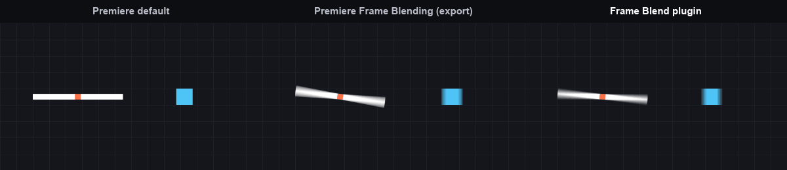
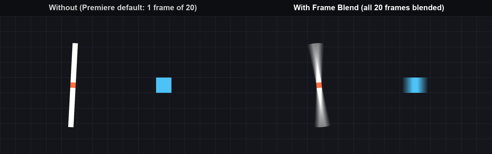
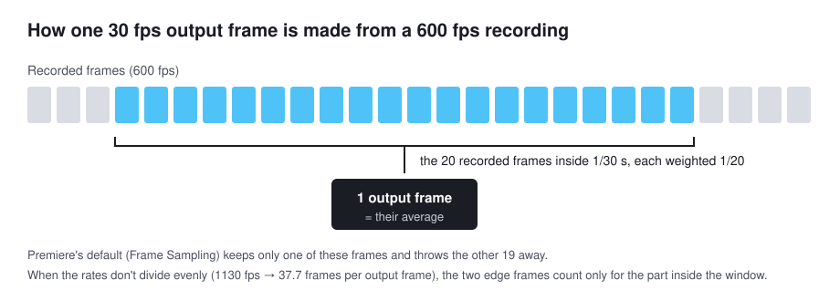

# Frame Blend

**Real frame blending for Adobe Premiere Pro and After Effects.** Record at 240, 480, 600 or 1000+ fps, edit on a 30 or 60 fps timeline, and every output frame becomes the blend of all the recorded frames it covers: smooth, natural motion blur instead of choppy frames. The look matches VEGAS Pro's frame blending ("Smart Resample"), which Premiere doesn't have.

> [!NOTE]
> **This project is vibe coded.** The code was written by AI coding agents (**OpenAI Codex** and **Anthropic's Claude Code**), directed and tested by a human on real recordings. It works in the tests listed below, but read the code before relying on it, and expect rough edges.

## What it does

Premiere Pro's options for high frame rate footage on a slower timeline:

- **Frame Sampling** (the default) shows **one** recorded frame per output frame and throws the rest away: at 600 fps on a 30 fps timeline, 19 of every 20 frames are lost, and fast motion looks jerky.
- **Frame Blending** (Premiere's own) is only applied when you **export**: while you play in the timeline you see sampled frames. And in our test it blended only about **half** of each output frame's time span (the smear is half as long as the motion during that frame).
- **Optical Flow** invents in-between frames and warps fast motion.

Frame Blend averages **all** the recorded frames that fall inside each output frame, the full 1/30 s, both when you play and when you export:

All three images are real **Premiere Pro 2026 exports** of the same 600 fps test clip on a 30 fps sequence, at the same frame: the clip's Time Interpolation set to *Frame Sampling*, then to *Frame Blending* without the plugin, then with Frame Blend. The spinning bar and the sliding square show the motion blur a real camera with a 360° shutter would capture over that 1/30 s.

## Install

1. Close Premiere Pro, After Effects and Media Encoder.
2. Download `FrameBlend-Setup-1.4.2.exe` from the [Releases](../../releases) page and run it. Windows may warn about an "unknown publisher": the installer isn't code-signed. Click *More info › Run anyway*.
3. Start Premiere Pro or After Effects.

Uninstall from *Settings › Apps › Installed apps › Frame Blend*.

**Requirements:** Windows 10 or 11 (64-bit), Premiere Pro or After Effects 2020 or later. In Premiere, GPU acceleration must be on (*File › Project Settings › General › Renderer: Mercury Playback Engine GPU Acceleration*, CUDA or OpenCL).

## Use

### Premiere Pro

- Put a high frame rate clip on a sequence with a lower frame rate. Frame Blend is added **automatically**, with the clip's *Time Interpolation* set to *Frame Blending*.
- **Turn it off for a clip:** right-click the clip › *Time Interpolation* › *Frame Sampling*. Choose *Frame Blending* to turn it back on. Works on many selected clips at once.
- Speed changes (*Speed/Duration*), reverse and time remapping (speed ramps) are blended along the curve.
- You can also add it by hand: *Effects › Video Effects › Frame Blending › Frame Blend*.

### After Effects

- *Effect › Frame Blending › Frame Blend* on a high frame rate layer in a lower frame rate composition.
- The source frame rate comes from the footage (*Interpret Footage › Frame Rate*) or the precomp. Works in 8, 16 and 32-bit projects.

## How it works

For an output frame centred on source position *c*, with *R* = source fps / output fps recorded frames per output frame, recorded frame *j* gets the weight

  **w(j) = |[j − ½, j + ½] ∩ [c − R/2, c + R/2]| / R**

the share of frame *j* that falls inside the output frame's time window. The weights always add up to exactly 1 and are computed with exact fractions from the hosts' rational frame rates, so 59.94 or 1130.28 fps are handled precisely. Frames are blended as they were encoded (gamma-encoded RGB), like VEGAS. When the timeline is at least as fast as the clip, frames pass through unchanged.

Under the hood:

- **Premiere Pro** only hands effects frames on the sequence's own frame grid, so the plugin decodes the clip's file itself (FFmpeg; GPU decoding for HEVC/AV1), uploads the frames to Premiere's GPU and blends them there with CUDA or OpenCL. It reads ahead while you play, keeps the frames around the playhead for pause and play, and handles variable frame rate recordings (dropped or frozen frames hold the previous frame).
- **After Effects** hands effects any source time, so the plugin asks for each covered frame and blends them on the CPU (multi-frame rendering supported).
- A small hidden Premiere extension (the "companion") adds the effect to new high frame rate clips.

The blending core is Rust (`src/`), with a C interface (`include/frame_blend.h`) used by the C++ plugin (`plugins/adobe/`). `fb_render` is an offline command-line renderer using the same core.

## Tested

| | Version | Result |
|---|---|---|
| Premiere Pro | 2023 (23.4), 2025 (25.2, 25.6), 2026 (26.5) | exported frames match the reference renderer within 1/255 |
| After Effects | 2025 (25.2) | 8, 16, 32 bpc: matches the weighted sum of AE's own frames |
| Playback | Premiere 2023, 1130 fps 720p recording on a 30 fps sequence | real time, no dropped frames after start; pause shows the blended frame instantly |
| Large project | Premiere 2025 (25.6), 32 different 480-960 fps 720p recordings | opens without running out of memory; Frame Blend's decoded frames stay within 2 GB (1.4.1 filled 16 GB and crashed) |
| Hardware | Windows 11, Ryzen 5 5600, GeForce RTX 2060 (CUDA) | |

Not tested yet: Premiere Pro 2020-2022, 2024; other After Effects versions; AMD and Intel GPUs (the OpenCL path is only checked by the parity tests); time remapping in After Effects.

## Limitations

- **Windows only.** No macOS build.
- **Premiere needs GPU acceleration.** With the software-only renderer, Premiere hands the effect only one frame per output frame, so there is nothing to blend.
- **Jumping far across the timeline** can take up to about half a second to show the first blended frame: decoding starts from the recording's last keyframe. A keyframe interval of 1 s in your recorder (OBS: *Keyframe Interval*) keeps it short.
- **Many high frame rate recordings use a lot of memory in Premiere itself:** opening a project with 32 of them took Premiere 2025 to about 13 GB for a minute, with or without Frame Blend. Frame Blend keeps its own decoded frames within an eighth of your RAM (at most 2 GB).
- **Very high frame rate H.264** (level 6.1, such as 1000+ fps at 720p) can't use the GPU decoder on many cards, so it decodes on the CPU, and Premiere does too: exports are slower than real time on mid-range CPUs.
- DaVinci Resolve isn't supported: Resolve gives effects frames already conformed to the timeline's rate, so there is nothing left to blend.

## Troubleshooting

To record a log for a bug report, create an empty file named `FrameBlend-log.txt` in your temp folder (type `%TEMP%` in the Explorer address bar), restart Premiere or After Effects, reproduce the problem, and attach that file to an issue. The log is only written while the file exists.

## Build from source

See [docs/plugin-build.md](docs/plugin-build.md). You need Rust, Visual Studio Build Tools, the CUDA toolkit, and Adobe's free After Effects and Premiere Pro SDKs (not included: Adobe's licence doesn't allow it). `tools/build_installer.ps1` builds everything and produces the installer.

## License

[MIT](LICENSE): use it, change it, fork it, ship it.

Frame Blend uses [FFmpeg](https://ffmpeg.org) under the [LGPL 3](dependence/sdks/FFmpeg_8.1_lgpl_win64/LICENSE.txt), loaded as unmodified shared DLLs. Adobe, Premiere Pro, After Effects and VEGAS Pro are trademarks of their owners; this project isn't affiliated with them.
